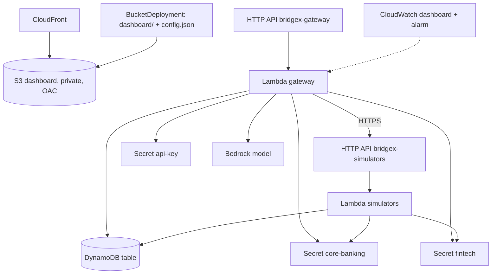

# Design: U4 Platform Infrastructure

## Files
- `bridgex/cdk.json`: `"app": "npx tsx infra/bin/app.ts"`.
- `bridgex/infra/bin/app.ts`: creates `BridgeXStack` with `env: { account: CDK_DEFAULT_ACCOUNT, region: 'us-east-1' }`.
- `bridgex/infra/lib/bridgex-stack.ts`: all resources.

## Resource graph

No cycle: CORS on the gateway API depends on the distribution domain, `config.json` depends on the gateway URL, and the distribution depends on neither.

## Environment variables
Gateway: `TABLE_NAME`, `API_KEY_SECRET_ARN`, `CORE_BANKING_SECRET_ARN`, `FINTECH_SECRET_ARN`, `CORE_BANKING_URL`, `FINTECH_URL`, `BEDROCK_MODEL_ID`. Simulators: `TABLE_NAME`, `CORE_BANKING_SECRET_ARN`, `FINTECH_SECRET_ARN`.

## Sizes
Gateway: 512 MB, 25 s timeout (HTTP API limit is 30 s). Simulators: 256 MB, 10 s (6 s timeout chaos plus margin).

## Deployment execution (stage 4.3)
1. `npm run check` and `npm run synth`.
2. `npm run deploy` with credentials sourced from `~/.bridgex-aws-env`.
3. `scripts/show-api-key.sh` reads the key from Secrets Manager.
4. `scripts/smoke.sh <GatewayUrl> <key>`; results go to `aidlc/.../operation/deployment-execution/deployment-log.md`.
