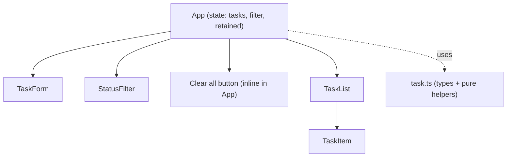

# Design Document: Task List

## Overview

A single-page, client-side task list in `idea-board/`. The user adds tasks, ticks them done or not done, and filters the list by status, and can clear all tasks after a confirmation. All state lives in React `useState` inside `App`. The visible list is derived during render and never stored. The starter demo content is replaced.

Several behaviors depend on unanswered Open Questions in `requirements.md`. Those choices are listed as assumptions under **Provisional decisions**. Nothing there is final.

## Architecture

`App` owns three pieces of state: `tasks: Task[]`, `filter: Filter`, and `retained: string[]` (ids of tasks toggled since the last filter selection). Child components are presentational and receive data and callbacks as props. Pure helpers in `task.ts` hold the logic, so components stay thin.



Data flow per render: `visibleTasks = filterTasks(tasks, filter, retained)`. Handlers:

- Toggle: `setTasks(toggleTask(...))` and add the id to `retained` if absent. The task stays visible under Done or Not done, so its checkbox is not unmounted and keyboard focus stays on it.
- Select filter: `setFilter(value)` and `setRetained([])`. Selecting any option, including the current one, clears `retained`.
- Add: `setTasks(addTask(...))` only. `retained` is untouched, so a new task is shown only if it matches the filter (see provisional decision 3).
- Clear all: `if (window.confirm('Clear all tasks?')) { setTasks([]); setRetained([]) }`. Cancel changes nothing. `filter` and the `TaskForm` draft are not touched, and the draft lives in `TaskForm` state, so `App` cannot reset it by accident. After a clear, `visibleTasks` is empty and `TaskList` shows the empty message.

## Components and Interfaces

Files under `idea-board/src/`, one component per file. Component files export only components (react-refresh rule). Types and helpers sit in `task.ts`.

| File | Role |
|---|---|
| `task.ts` | `Task`, `Filter` types, `FILTER_OPTIONS`, `addTask`, `toggleTask`, `filterTasks`. No React. |
| `App.tsx` | State, handlers, derived `visibleTasks`, page layout, heading. Replaces the starter. |
| `App.css` | Page layout. Replaces the starter styles. |
| `TaskForm.tsx` | Labelled text input plus Add button in a `<form>`. Owns the draft text state. |
| `StatusFilter.tsx` + `StatusFilter.css` | Group of three buttons. |
| Clear all button | Inline `<button type="button" disabled={tasks.length === 0}>Clear all</button>` in `App`, between `StatusFilter` and `TaskList`. No new file: it is one element with one handler that needs `tasks`, `setTasks`, and `setRetained`, so a component would only forward props. |
| `TaskList.tsx` | `<ul>` of `TaskItem`, or the empty message when the list is empty. |
| `TaskItem.tsx` + `TaskItem.css` | `<li>` with a checkbox and a label. Done style applied here. |

`index.css` keeps global styles. Starter rules that only served the demo are removed. `public/icons.svg`, unused files in `src/assets/`, and the `/icons.svg` reference go with the starter content. The new UI uses no assets, so no `BASE_URL` handling is needed.

```ts
// task.ts
export type Task = { id: string; text: string; done: boolean }
export type Filter = 'all' | 'done' | 'active'
export const FILTER_OPTIONS: { value: Filter; label: string }[] = [
  { value: 'all', label: 'All' },
  { value: 'done', label: 'Done' },
  { value: 'active', label: 'Not done' },
]
export function addTask(tasks: Task[], text: string, id: string): Task[]
export function toggleTask(tasks: Task[], id: string): Task[]
// Under 'all': every task. Otherwise: tasks matching the filter by done status,
// plus any task whose id is in `retained`. Original order is kept.
export function filterTasks(tasks: Task[], filter: Filter, retained: string[]): Task[]
```

No `clearTasks` helper is added to `task.ts`: clearing is `setTasks([])`, so a helper would add nothing to test or reuse.

Component props:

- `TaskForm`: `{ onAdd: (text: string) => void }`. On submit, if the draft is not blank it calls `onAdd` and clears the draft. Otherwise it does nothing and keeps the draft.
- `StatusFilter`: `{ value: Filter; onChange: (f: Filter) => void }`. `App` passes a handler that sets the filter and clears `retained`. The component does not know about `retained`.
- `TaskList`: `{ tasks: Task[]; onToggle: (id: string) => void }`.
- `TaskItem`: `{ task: Task; onToggle: (id: string) => void }`.

Markup (covers Requirements 3 and 6):

- Add form: `<form>` with `<label htmlFor>` bound to the input, and a `type="submit"` button. Enter submits through the native form behavior.
- Filter: `<div role="group" aria-label="Filter tasks">` holding `<button type="button" aria-pressed>`. The active button also gets a distinct style that does not rely on color alone (for example bold text plus an outline).
- List: `<ul>` with `<li>`. Each item has `<input type="checkbox" id>` and a `<label htmlFor>` containing the task text, which gives the checkbox its accessible name. Done text uses `text-decoration: line-through` plus a muted color.
- Empty message: a `<p>` shown instead of the `<ul>`.

## Data Models

`Task` is a plain object: `id` (string from `crypto.randomUUID()`, called in the add handler, not during render), `text` (string), `done` (boolean). `Filter` is a string union. There are no enums. State is an array in order of insertion, the current filter, and `retained`, an array of task ids without duplicates (an id appears at most once). `retained` is view state only: it never changes a task and is reset on every filter selection. Nothing is persisted.

## Provisional decisions

These are assumptions, not answers. Each can be changed after the user responds. Number 2 is resolved (see below) and is not listed.

**Resolved (former decision 2): toggle under an active filter.** A toggled task stays visible until the user next selects a filter option. The mechanism is the `retained` state described under Architecture. Adding a task does not interact with `retained`: new ids are never added to it.

| # | Open question | Provisional choice | Touches | If the user answers differently |
|---|---|---|---|---|
| 1 | Order of new tasks; position on toggle | New task is appended at the bottom. Toggling keeps position (the array order is never changed by toggle). | Req 1.1, 1.3, 3.3, 3.4 | Top: `addTask` prepends instead of appends. Done tasks moved to the end: `filterTasks` or a render-time sort changes. Both are one-function changes. |
| 3 | Adding while the Done filter is active | The new task stays hidden and the filter is not changed. The input still clears. | Req 1.3, 1.4 | If the filter should switch to All, `App`'s add handler also calls `setFilter('all')`. |
| 4 | Text handling | Text is stored trimmed. No maximum length. Duplicates are allowed. | Req 1.1, 2.1 | Stored as typed: remove `trim()` in `addTask` (blank check stays). Max length: add `maxLength` on the input and a check in `addTask`. No duplicates: `addTask` compares against existing text and needs a rejection message path. |
| 5 | Requirement 6 (accessibility) | Treated as confirmed, because steering requires semantic, labelled, keyboard-operable UI. The markup above follows it. | Req 6.1 to 6.6 | If removed, the markup stays (steering still applies), but no design commitment remains for the focus rule in 6.6 or the `aria-pressed` state. |
| 6 | Form of the Status_Filter | Three buttons with `aria-pressed`. | Req 4.1, 4.6, 6.5 | Radios: `StatusFilter` renders a `<fieldset>` with `<legend>` and radio inputs, and the state attribute is the native checked state. Select: a labelled `<select>`. Props and `Filter` type are unchanged. Only `StatusFilter.tsx` and its CSS change. |
| 7 | No persistence | Tasks are lost on reload. | Req 7.1 | If persistence is wanted, a `localStorage` read in the initial state and a write effect in `App` would be added. This needs its own decision on failure handling and format. |
| 8 | Empty message wording (not in the questions) | One message for all cases: "No tasks to show." | Req 5.1, 5.2 | Different text per filter, or a separate first-use message, is a change inside `TaskList.tsx`. |
| 9 | Clear all with no tasks (Open Question 8) | The button is disabled when there are no tasks, so no confirmation appears for nothing. | Req 8.8 | Hidden: render the button only when `tasks.length > 0`. Always enabled: drop `disabled` and skip the confirm when `tasks.length === 0`. One-line change in `App.tsx`. |
| 10 | Clear all placement (Open Question 9) | Directly above the list, below the `StatusFilter`. | Req 8.1 | Moving it is a change to the JSX order in `App.tsx`. |

Not a provisional decision: clearing also empties `retained`, because its ids would refer to tasks that no longer exist (Req 8.4). Clear all also changes the earlier "Tasks cannot be deleted" assumption, see Error Handling. After a clear, the focused button becomes disabled under decision 9, so the browser moves focus out of it. This is accepted for now.

## Correctness Properties

*A property is a characteristic or behavior that should hold true across all valid executions of a system-essentially, a formal statement about what the system should do. Properties serve as the bridge between human-readable specifications and machine-verifiable correctness guarantees.*

These apply to the pure helpers in `task.ts`. UI rendering, styling, and accessibility are not expressed as properties. The BRD puts automated tests out of scope, so these properties are statements of intended behavior to review against, not a commitment to write tests. They assume the provisional decisions above.

### Property 1: Adding a non-blank task appends one not-done task and keeps the rest

For any task list and any string with at least one non-whitespace character, `addTask` returns a list whose length is one greater, whose existing tasks are unchanged and in the same order, and whose new task has the trimmed text and `done` equal to false.

**Validates: Requirements 1.1, 1.2, 1.5**

### Property 2: Blank entries are rejected

For any task list and any string made only of whitespace (including the empty string), `addTask` returns a list equal to the input.

**Validates: Requirements 2.1**

### Property 3: Toggle changes exactly one task, and toggling twice restores the list

For any task list and any id present in it, `toggleTask` flips `done` on that task only, leaving all other tasks and the order unchanged. Applying it twice yields a list equal to the original.

**Validates: Requirements 3.3, 3.4**

### Property 4: Filtering selects by status or retention without changing tasks

For any task list and any `retained` list of ids, `filterTasks(tasks, 'all', retained)` equals `tasks`. `filterTasks(tasks, 'done', retained)` contains exactly the tasks that have `done` true or whose id is in `retained`. `filterTasks(tasks, 'active', retained)` contains exactly the tasks that have `done` false or whose id is in `retained`. Results keep the original order, and the input list is not modified.

**Validates: Requirements 3.6, 4.3, 4.4, 4.5, 4.7, 1.3**

### Property 5: Empty retained list gives pure status filtering

For any task list and any filter, `filterTasks(tasks, filter, [])` contains exactly the tasks that match the filter by current `done` value. This is the state after any filter selection.

**Validates: Requirements 4.4, 4.5, 4.8**

## Error Handling

There are no I/O or network paths. Individual tasks cannot be deleted, and Clear all empties `retained` together with `tasks`, so every id in `retained` refers to an existing task, and an unknown id would have no effect. Cancelling `window.confirm` is a normal path that changes no state. If a browser suppresses dialogs, `confirm` returns false and nothing is cleared. The only rejected input is a blank entry, which is silently ignored with the draft kept as typed (Req 2). If `crypto.randomUUID` is unavailable (non-secure context), id creation would throw. The IDE proxy serves HTTPS and `localhost` counts as secure, so this is not handled further.

## Testing Strategy

Automated tests are out of scope per the BRD, and no test framework is installed. Steering says not to add one without asking. Verification is `npm run lint` and `npm run build` (Req 7.6), plus manual checks in the browser at `/absproxy/5173/`: add by button and by Enter, blank entry, toggle, toggle under Done and Not done (task stays, focus stays on its checkbox, task leaves after reselecting a filter), each filter, empty message, keyboard-only use, and a screen-reader label spot check. Clear all: button disabled with no tasks; with tasks, cancel keeps everything; confirm empties the list and shows the empty message, with the filter and typed input text unchanged; after toggling under Done, clearing and adding new tasks shows no stale retained tasks.

No correctness property is added for Clear all. It has no pure helper, and "clearing yields an empty list" is `setTasks([])`, which is covered by the manual check.

Property-based testing would suit the five properties above if the user later approves a test setup (for example `vitest` with `fast-check`, at least 100 runs each, tagged `Feature: task-list, Property N`). That needs a separate decision and is not part of this spec.
