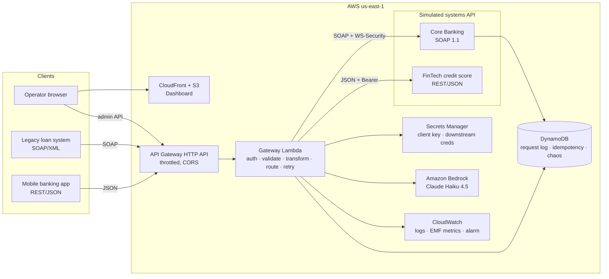

# Domain Design: Components

**Stage**: 2.6 Domain Design
**Lead role**: architect, supported by aws-platform
Decisions: [decisions.md](decisions.md).

## Architecture

## Components
| Component | Responsibility | Code |
|---|---|---|
| Transformation Engine | XML parsing with safety checks, SOAP envelope build and parse, fault handling, declarative mapping, type conversion, schema validation, masking | `bridgex/src/transform/` |
| Integration Registry | Load and validate integration documents, resolve placeholders, match routes and SOAP operations | `bridgex/src/config/` |
| Gateway Pipeline | Auth → route → parse → validate → idempotency → transform → call with retry → transform back → log → metrics | `bridgex/src/gateway/pipeline.ts` |
| Downstream Client | HTTP call with per-attempt timeout, retry policy, credential injection | `bridgex/src/gateway/http-client.ts`, `retry.ts` |
| Stores | DynamoDB request log, idempotency records and chaos control; in-memory versions for tests and local runs | `bridgex/src/gateway/store*.ts` |
| Admin API | Stats, request list and detail, transform preview, chaos, mapping suggestions | `bridgex/src/gateway/admin.ts` |
| AI Mapping Assistant | Bedrock Converse with a forced tool schema; validates suggestions against the samples | `bridgex/src/gateway/ai-mapping.ts` |
| Simulated Core Banking | SOAP 1.1 service with three operations, faults, WS-Security check, chaos | `bridgex/src/simulators/core-banking.ts` |
| Simulated FinTech | REST credit-score API with Bearer check, chaos | `bridgex/src/simulators/fintech.ts` |
| Dashboard | Static web app: overview, playground, transformation studio, AI mapping, integrations | `bridgex/dashboard/` |
| Platform | CDK stack: APIs, Lambdas, table, secrets, CloudFront, CloudWatch | `bridgex/infra/` |

## Request flow (REST → SOAP)
1. API Gateway passes the request to the gateway Lambda.
2. The pipeline checks `x-api-key`, finds the integration by method and path, parses and validates the JSON.
3. The engine maps fields and builds the SOAP envelope; the client adds the WS-Security header from Secrets Manager.
4. The client sends the request with a 2.5 s timeout and retries if the policy allows.
5. The engine parses the SOAP response or fault and maps it to JSON.
6. The pipeline writes the masked request record to DynamoDB and an EMF metric line to CloudWatch, then returns the JSON with `x-bridgex-request-id`.

The SOAP → REST flow is the mirror image: the operation comes from the first element in the SOAP Body, and errors return as SOAP faults.
