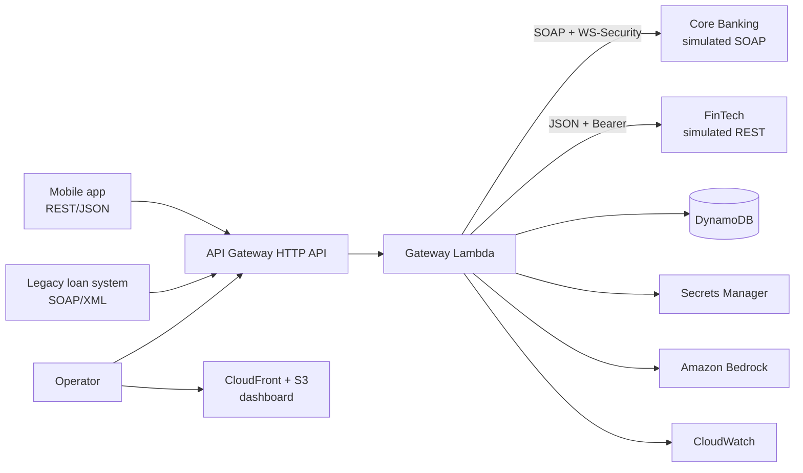

# BridgeX

**Connecting legacy systems to the modern world.** BridgeX is a serverless gateway on AWS that translates between legacy SOAP/XML services and modern REST/JSON applications, in both directions, from configuration. The legacy system doesn't change, and its credentials never leave the gateway.

Built for a hackathon on 2026-11-20 with Kiro, following the AWS AI-Driven Development Life Cycle (AI-DLC). The full lifecycle record is in [`../aidlc/spaces/default/intents/261120-bridgex-mvp/`](../aidlc/spaces/default/intents/261120-bridgex-mvp/aidlc-state.md).

## What it does
| Capability | Example |
|---|---|
| REST/JSON → SOAP/XML → REST/JSON | Mobile app posts `{"accountId":"ACC101"}`, gets `{"accountId":"ACC101","availableBalance":50000,"currency":"INR"}` from a SOAP core banking system |
| SOAP/XML → REST/JSON → SOAP/XML | Legacy loan system sends `GetCreditScore` SOAP and gets a SOAP reply from a modern FinTech REST API |
| Declarative mapping | Renames, nested paths, types, `yyyyMMdd`/`ddMMyyyy`/ISO dates, code lookups (`CR` → `credit`), defaults, repeating elements |
| Validation and safe XML | Schema checks before any downstream call; DOCTYPE/ENTITY rejected; 64 KB limit; escaped output |
| Errors that make sense | SOAP faults become HTTP errors (`ACCOUNT_NOT_FOUND` → 404); SOAP clients get SOAP faults |
| Reliability | Timeouts, retries with backoff for idempotent operations only, `Idempotency-Key` replay for transfers |
| Security | API keys (constant-time check), WS-Security and Bearer credentials from Secrets Manager, masked request logs, least-privilege IAM |
| Monitoring | Request log with every transformation stage, live dashboard, CloudWatch metrics, dashboard and alarm |
| AI mapping | Amazon Bedrock suggests field mappings from two samples; BridgeX verifies every path and never applies them automatically |

## Architecture


## Run it
```bash
npm install
npm run check          # typecheck + 105 tests
npm run local          # everything on http://localhost:3000, no AWS needed; prints the API key

# AWS (us-east-1), with credentials in your shell
npm run deploy
scripts/show-api-key.sh
scripts/smoke.sh "$(jq -r .BridgeXStack.GatewayUrl cdk-outputs.json)" "<api-key>"
```

## Try it
```bash
curl -X POST "$URL/api/v1/accounts/balance" -H "x-api-key: $KEY" -H 'content-type: application/json' -d '{"accountId":"ACC101"}'

curl -X POST "$URL/soap/v1/LoanService" -H "x-api-key: $KEY" -H 'content-type: text/xml' -d '<soapenv:Envelope xmlns:soapenv="http://schemas.xmlsoap.org/soap/envelope/" xmlns:ln="http://legacybank.example.com/loans"><soapenv:Body><ln:GetCreditScore><ln:CustomerId>CUST1001</ln:CustomerId></ln:GetCreditScore></soapenv:Body></soapenv:Envelope>'
```
Seed data: accounts `ACC101`–`ACC104` (`ACC103` low balance, `ACC104` frozen), customers `CUST1001`–`CUST1003`.

## Add an integration
Add one JSON file to `src/config/integrations/` and list it in `index.ts`. The checklist is in `.kiro/steering/integration-mapping.md`. The tests transform its samples, so a broken mapping fails before deploy.

## Layout
`src/transform` (engine, pure functions) · `src/config` (integration documents, registry) · `src/gateway` (pipeline, admin API, AI mapping, Lambda) · `src/simulators` (SOAP core banking, REST FinTech) · `dashboard/` (static UI) · `infra/` (CDK) · `scripts/` (local server, smoke test) · `test/` (Vitest).
